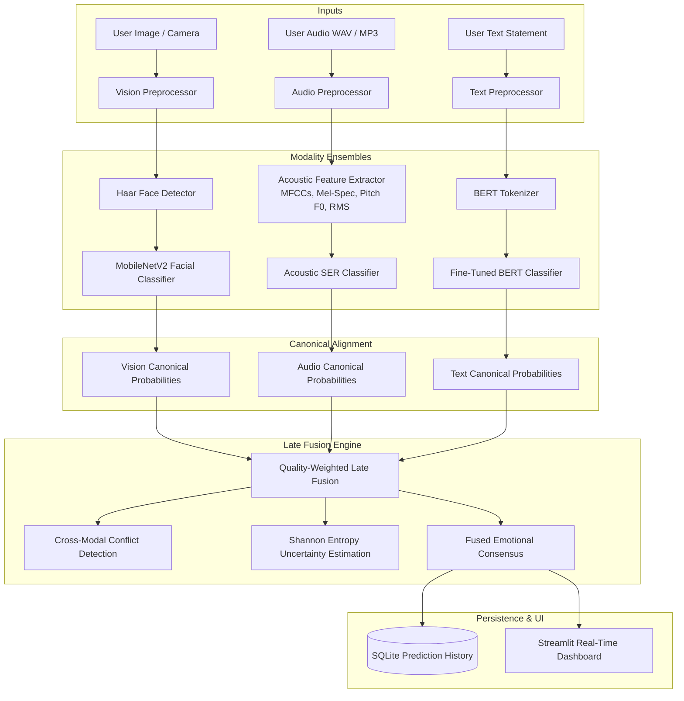

# System Architecture & Technical Specifications

## 1. High-Level System Architecture

The **AI-Powered Multimodal Emotion Analysis Platform** integrates Computer Vision, Acoustic Speech Emotion Recognition (SER), and Transformer Natural Language Processing (NLP) into a unified perception pipeline.



---

## 2. Canonical Emotion Taxonomy

To enable principled late fusion without ad-hoc probability distortions, all modalities project their native label distributions onto the **7 Canonical Ekman Emotions**:

$$\mathcal{E} = \{\text{angry}, \text{disgust}, \text{fear}, \text{happy}, \text{neutral}, \text{sad}, \text{surprise}\}$$

### Modality Alignments

| Modality | Native Training Labels | Mapping to Canonical $\mathcal{E}$ |
| :--- | :--- | :--- |
| **Vision** | `angry`, `disgust`, `fear`, `happy`, `neutral`, `sad`, `surprise` | $1:1$ Identity mapping |
| **Audio** | `angry`, `disgust`, `fear`, `happy`, `neutral`, `sad`, `surprise` | $1:1$ Acoustic SER mapping |
| **Text** | `anger`, `fear`, `joy`, `love`, `sadness`, `surprise`, `neutral` | `joy`, `love` $\to$ `happy`; `sadness` $\to$ `sad`; `anger` $\to$ `angry` |

---

## 3. Modality Pipelines

### 3.1 Vision Pipeline
1. **Face Detection**: Uses OpenCV Haar Cascade (`haarcascade_frontalface_default.xml`) with histogram equalization to localize all human faces.
2. **Preprocessing**: Extracted crops receive a proportional margin ($15\%$), are resized to $(96, 96)$, converted to RGB, and normalized to float32 $[0, 1]$.
3. **Inference**: Evaluated using MobileNetV2 with an unfreezed classification head outputting softmax logits.
4. **Multi-Face Handling**: Ranks detected faces by bounding box area; outputs primary face consensus and per-face annotations.

### 3.2 Audio Pipeline (Acoustic SER)
1. **Preprocessing**: Mono channel downmixing, resampling to $16{,}000\text{ Hz}$, duration validation ($0.5\text{s} - 60.0\text{s}$), and silence/RMS gating.
2. **Feature Extraction**:
   - 13 Mel-Frequency Cepstral Coefficients (MFCC mean and variance = 26 features)
   - 12 Chromagram STFT pitch class means
   - 7 Spectral Contrast band means
   - Fundamental frequency ($F_0$ pitch) via the YIN algorithm and pitch variability
   - Root Mean Square (RMS) energy and Zero-Crossing Rate (ZCR)
3. **Classification**: Evaluates prosodic pitch excursions, energy dynamics, and spectral slope to calibrate emotion class probabilities.

### 3.3 Text Pipeline
1. **Preprocessing**: Character sanitation, quotation mark standardization, whitespace normalization, and boundary enforcement ($2 - 1000$ characters).
2. **Tokenizer**: `bert-base-uncased` WordPiece tokenizer (max sequence length 128 tokens).
3. **Classifier**: Fine-tuned `BertForSequenceClassification` checkpoint loaded directly into memory without memory-mapping crashes on Windows.

---

## 4. Multimodal Late Fusion Mathematical Formulation

### 4.1 Quality-Aware Dynamic Weighting
Let $\mathcal{M}_{\text{active}} \subseteq \{\text{vision}, \text{audio}, \text{text}\}$ be the set of active modalities.
Each active modality possesses a base prior weight $w_m^{\text{base}}$:
- $w_{\text{vision}}^{\text{base}} = 0.40$
- $w_{\text{audio}}^{\text{base}} = 0.35$
- $w_{\text{text}}^{\text{base}} = 0.25$

Each modality's effective weight is modulated by a quality factor $q_m \in [0, 1]$:
$$w_m^{\text{eff}} = w_m^{\text{base}} \cdot q_m$$

- $q_{\text{vision}} = 0.65$ if no face was localized and the frame fallback was used; $1.0$ otherwise.
- $q_{\text{audio}} = 0.70$ if duration is $< 1.5\text{s}$; $1.0$ otherwise.
- $q_{\text{text}} = 0.70$ if word count $< 3$; $1.0$ otherwise.

Normalized weights are computed as:
$$\widetilde{w}_m = \frac{w_m^{\text{eff}}}{\sum_{k \in \mathcal{M}_{\text{active}}} w_k^{\text{eff}}}$$

### 4.2 Fused Probability Distribution
For each emotion $e \in \mathcal{E}$:
$$P_{\text{fused}}(e) = \sum_{m \in \mathcal{M}_{\text{active}}} \widetilde{w}_m \cdot P_m(e)$$

### 4.3 Conflict Detection
Each canonical emotion is mapped to an emotional valence category:
$$\mathcal{V}(e) \in \{\text{positive}, \text{positive\_arousal}, \text{neutral}, \text{negative\_low\_arousal}, \text{negative\_high\_arousal}\}$$

A cross-modal conflict is flagged if:
$$\exists\, m_1, m_2 \in \mathcal{M}_{\text{active}} \quad \text{such that} \quad \mathcal{V}(\hat{e}_{m_1}) \neq \mathcal{V}(\hat{e}_{m_2}) \quad \text{and} \quad \text{neither is neutral}$$

### 4.4 Uncertainty Estimation and Abstention
Shannon entropy $H$ in bits measures distribution spread:
$$H(P_{\text{fused}}) = -\sum_{e \in \mathcal{E}} P_{\text{fused}}(e) \log_2 P_{\text{fused}}(e)$$

The system **abstains** from issuing a definitive prediction if:
$$\max_{e} P_{\text{fused}}(e) < 0.30 \quad \text{or} \quad (H > 1.60 \text{ bits and a cross-modal conflict exists})$$

---

## 5. Storage and Database Schema

Database: SQLite (`emotion_platform.db`)

```sql
CREATE TABLE prediction_history (
    id INTEGER PRIMARY KEY AUTOINCREMENT,
    timestamp DATETIME DEFAULT CURRENT_TIMESTAMP,
    modality TEXT NOT NULL,
    dominant_emotion TEXT NOT NULL,
    confidence REAL NOT NULL,
    probabilities_json TEXT NOT NULL,
    metadata_json TEXT,
    notes TEXT
);

CREATE INDEX idx_pred_timestamp ON prediction_history(timestamp);
CREATE INDEX idx_pred_modality ON prediction_history(modality);
CREATE INDEX idx_pred_emotion ON prediction_history(dominant_emotion);
```

**Privacy Guarantee:** Raw user video frames and audio recordings are never committed to disk. Only processed feature predictions and metadata are retained in SQLite, with an on-demand history clearance mechanism.
